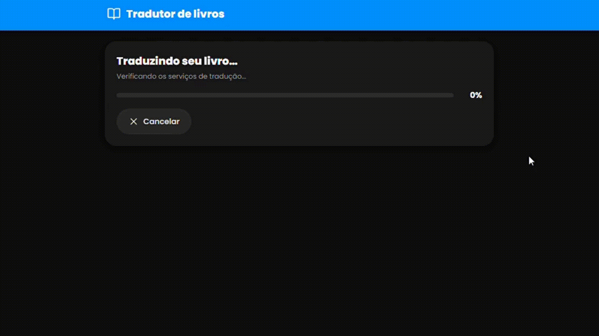

# 📚 Tradutor de Livros

> **Traduza seus livros em EPUB e PDF diretamente no navegador — 100% local, sem instalação, sem servidor, sem cadastro e gratuito!**

 

---

## ✨ Sobre o projeto

O **Tradutor de Livros** é uma aplicação web que permite traduzir livros completos nos formatos **EPUB** e **PDF** sem enviar nenhum arquivo para servidores externos. Todo o processamento acontece **diretamente no seu navegador**, garantindo **privacidade total** e funcionamento **offline** após o carregamento inicial.

Ideal para quem quer ler obras estrangeiras no idioma preferido sem depender de serviços pagos ou ferramentas complicadas.

---

## 🚀 Funcionalidades

- 📖 Suporte a arquivos **EPUB** e **PDF**
- 🔒 **100% no navegador** — seus arquivos nunca saem do seu dispositivo
- ⚡ Sem instalação, sem cadastro, sem servidor
- 🆓 Totalmente **gratuito** e open source
- 🎨 Interface simples e responsiva
- 📥 Download do livro traduzido no mesmo formato original ou outro

---

## 🖼️ Demonstração

### Tela inicial

### Processo de tradução

### Resultado final

---

⭐ **Se este projeto te ajudou, deixe uma estrela no repositório!** ⭐
